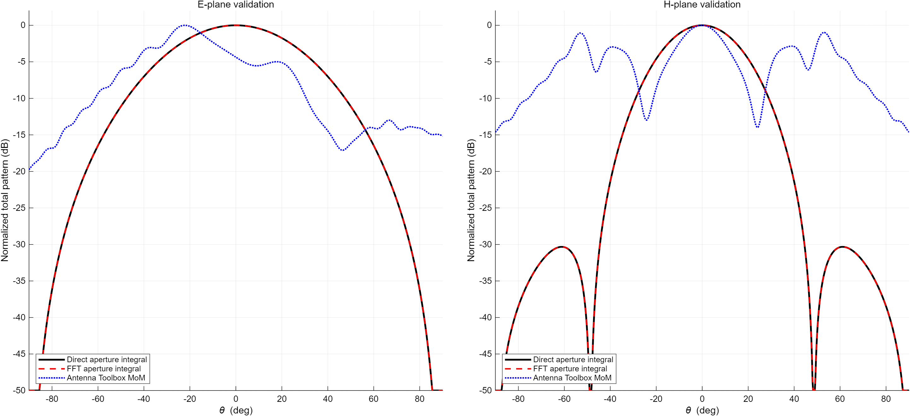
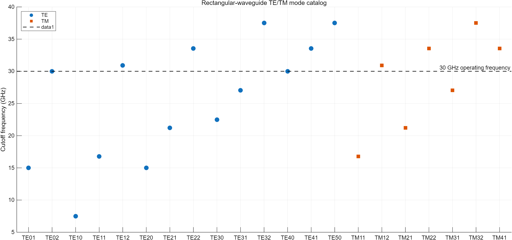
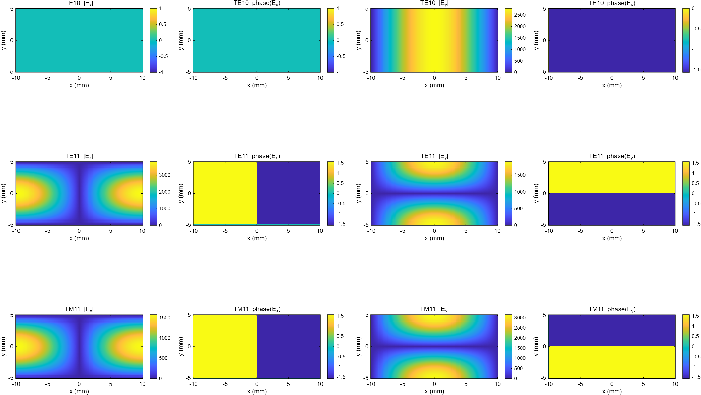
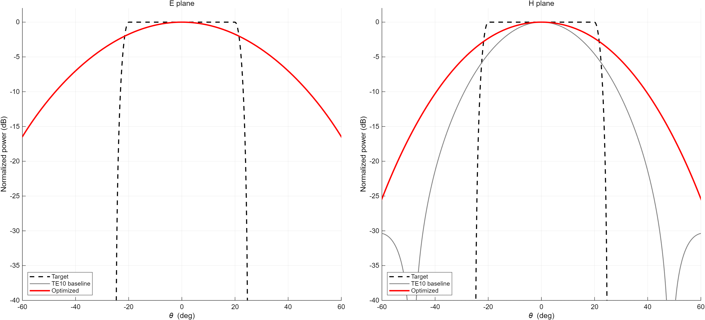
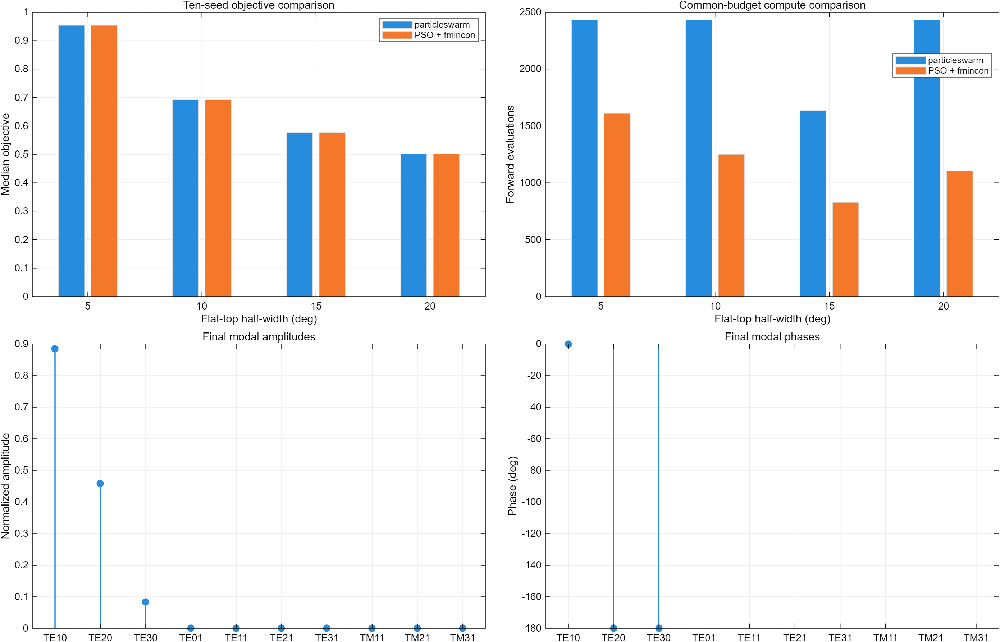

# 矩形波导多模远场合成：MATLAB 数值模型、优化与 HFSS 验证接口

这是一个固定尺寸（20 mm × 10 mm）、固定频率（30 GHz）的开口矩形波导数值工程。项目从课程脚本重构为可测试、可复现的矢量电磁计算流程：自动枚举 TE/TM 模式，以 1 W 传播功率归一化，分别用直接口径积分与真实空间频率 FFT 求远场，再比较多种模态权重优化方法。

> 当前结论边界：MATLAB 数值模型、FFT/直接积分一致性和 Antenna Toolbox 对照已实际运行；HFSS 2025 R2 能启动，但 API 无法创建 HFSS 设计，许可证未得到验证，因此 HFSS 保持 **BLOCKED**。本项目不声称已经完成多模馈电网络或实物测量。



## 当前结果

| 项目 | 实际状态 | 结果 |
|---|---:|---|
| MATLAB 核心测试 | PASS | 5/5：截止、PEC 边界、1 W 功率、模态正交、直接积分/FFT 与 TE10 极化参考 |
| 直接积分 vs FFT | PASS | E/H 面归一化功率 RMSE 分别约 `4.11e-7`、`1.22e-7`，峰值方向差均为 `0°` |
| 网格收敛 | PASS | 129×65 到 257×129：HPBW 变化约 `0.0068%`，边界指标变化约 `0.0004 dB` |
| Antenna Toolbox | EXECUTED / REFERENCE ONLY | 有限探针馈电模型已求解，但与理想口径并不重合：E/H 面主区域 RMSE 约 `4.62/6.39 dB` |
| 平顶波束门槛 | NOT MET | 5°/10°/15°/20° 均未同时满足 1 dB 波纹、−12 dB 区外最大值和 −15 dB 交叉极化 |
| 当前 Pareto 代表方案 | PARETO ONLY | 20° 半宽；最坏波纹约 `2.33 dB`，区外最大值约 `−2.72 dB`，不标记为达标 |
| 混合算法门槛 | PARTIAL | 20° 方案在目标近似相同时，中位前向计算次数减少约 `51.8%`；其余宽度未全部通过 |
| 200 次扰动试验 | PASS（限定模型） | 对已激励模态施加 ±0.5 dB、±5°；95% 旁瓣恶化不超过 3 dB |
| HFSS 全波验证 | BLOCKED | AEDT 2025 R2 已启动，但 HFSS 设计对象创建失败；无 HFSS 曲线或通过结论 |

上述状态来自仓库内已生成的 CSV/JSON，而不是手工填写的“预期结果”。详细边界见 [`docs/validation.md`](docs/validation.md)。

## 主要改进

- TE 模式允许一个下标为零但禁止 TE00；TM 模式要求 `m,n >= 1`。
- 严格使用 `fc < f`；30 GHz 边界上的 TE02、TE40 单列为 `cutoff`，不进入优化。
- 分别保留 `Ex,Ey,Hx,Hy`，不再用 `Ex + 1j*Ey` 伪装矢量场。
- 每个传播模式按口径上的时均 Poynting 功率归一化为 1 W。
- 直接积分与 FFT 是两套独立实现；FFT 的 `kx,ky` 由采样间隔生成，并使用相同二维梯形权重。
- 远场输出 `Eθ,Eφ`、TE10 的 y 向 Ludwig-3 共/交极化和总辐射强度。
- 优化同时评价 E 面与 H 面，固定 TE10 全局相位并统一总输入功率。
- 10 个固定随机种子比较 `particleswarm` 与“短 PSO + `fmincon`”；每次上限均为 3000 次前向评估。
- 未达到物理门槛时保留非支配前沿，不调整阈值、不删除异常结果。

## 一键复现

环境：MATLAB R2025a；优化需要 Global Optimization Toolbox；独立参考需要 Antenna Toolbox。HFSS 自动化脚本针对 AEDT 2025 R2 与本机已有的 PyAEDT 0.9.6 编写。

```matlab
cd('D:\homework\电磁学小论文\waveguide_farfield')
outputs = run_all();                    % 默认也尝试 HFSS；失败会写 BLOCKED
outputs = run_all('RunHfss',false);     % 仅重建 MATLAB/Antenna Toolbox 结果
```

也可分步运行：

```matlab
run_tests();
baseline = run_baseline();
optimization = run_optimization();
validation = run_validation();
```

HFSS 可单独运行：

```powershell
D:\Miniconda3\python.exe hfss\preflight.py --project-root .
D:\Miniconda3\python.exe hfss\build_and_solve.py --project-root . --solve
```

`results/hfss/hfss_status.json` 是 HFSS 状态的唯一依据；安装存在、工程已写出或脚本已配置都不等于全波验证通过。

## 仓库结构

```text
waveguide_farfield/
├─ matlab/+wg/              核心场、远场、指标与优化函数
├─ tests/                   MATLAB 单元测试
├─ hfss/                    PyAEDT 预检、建模、求解与导出脚本
├─ docs/                    理论、验证设置与证据边界
├─ results/
│  ├─ figures/              可复现图片
│  ├─ tables/               模式、方向图、权重、优化与验证 CSV
│  ├─ data/                 MATLAB 结构化结果
│  └─ hfss/                 HFSS 状态和将来的全波导出
├─ run_baseline.m
├─ run_optimization.m
├─ run_validation.m
└─ run_all.m
```

原始 11 个 MATLAB 脚本与小型图片保存在 Git 标签 `legacy-baseline` 中，不留在当前主分支。第三方近远场代码、教材 PDF、答辩大文件和命令窗口截图未导入。

## 结果图









## 局限性与下一道验证门

1. 当前远场模型是无限大 PEC 平面中的理想开口近似，没有把有限壁厚、外部法兰和真实馈电结构纳入 MATLAB 模型。
2. 所有传播模式被视为可独立设定幅相；项目没有设计能实现这些权重的多模馈电网络。
3. Monte Carlo 只扰动已设定的模态权重；未包含未激励端口模式的绝对泄漏、机械公差和材料误差。
4. HFSS 必须先解决设计创建/许可证或 PyAEDT 兼容问题，再完成端口本征模识别、单模和多模曲线导出，才能评价 1°、10% 和 2 dB 三项门槛。
5. 若 HFSS 与理想口径模型偏差较大，应保留结果并分别分析有限长度、端口模式、开口边缘绕射和 PML/网格设置。

## 个人工作内容

本项目展示的工作包括：电磁模式公式校核、功率归一化、双远场求解器、测试门槛、遗留 MATLAB 脚本重构、多算法公平预算比较、鲁棒性实验、结构化结果导出以及 PyAEDT 自动验证接口。结论刻意区分了“代码可运行”“数值门槛通过”“独立工具对照”和“HFSS/实物验证”。

## 参考资料

- D. M. Pozar, *Microwave Engineering*, rectangular waveguides and aperture radiation.
- C. A. Balanis, *Antenna Theory: Analysis and Design*, aperture antennas and polarization definitions.
- MathWorks documentation: `waveguide`, `pattern`, `particleswarm`, `fmincon`, and MATLAB Unit Test Framework.
- Ansys Electronics Desktop / PyAEDT documentation for driven-modal ports, adaptive convergence, PML, and infinite-sphere reports.
