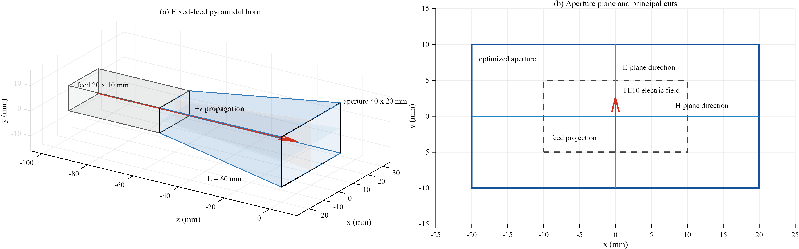
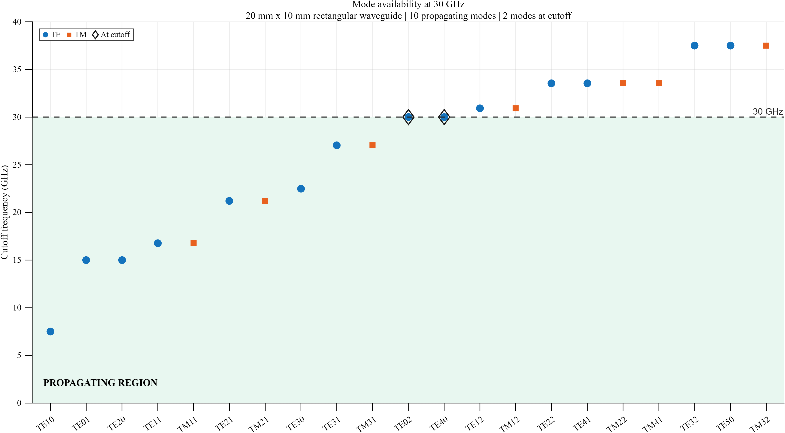
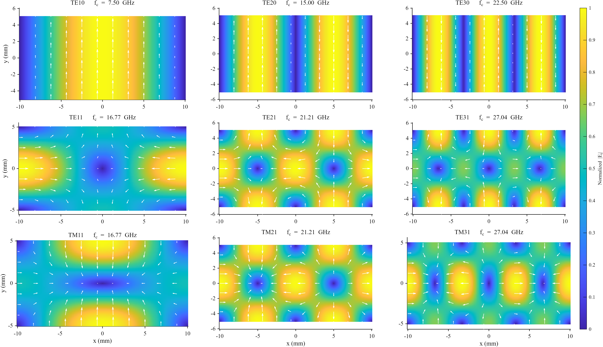
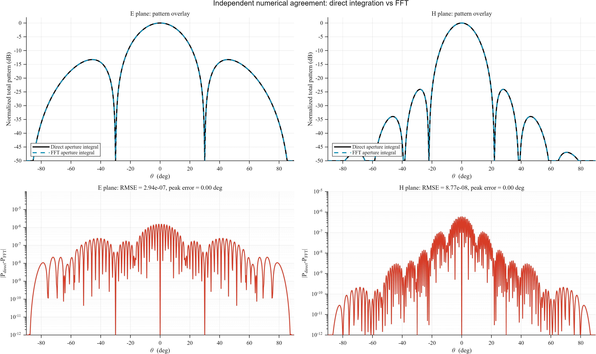
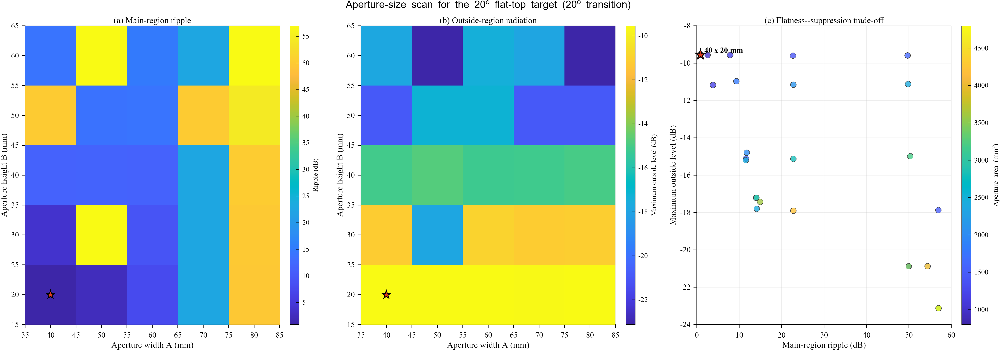
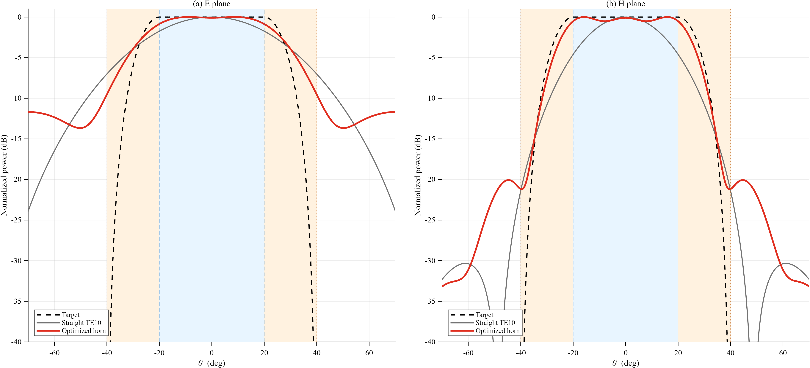
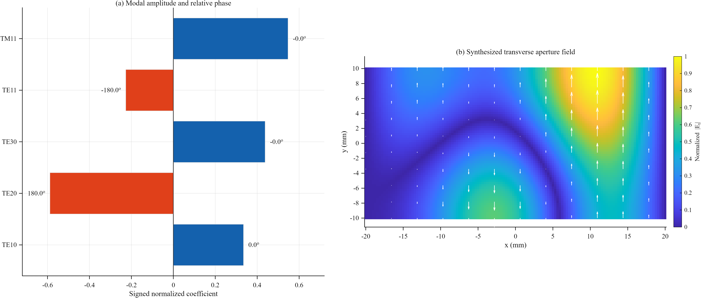
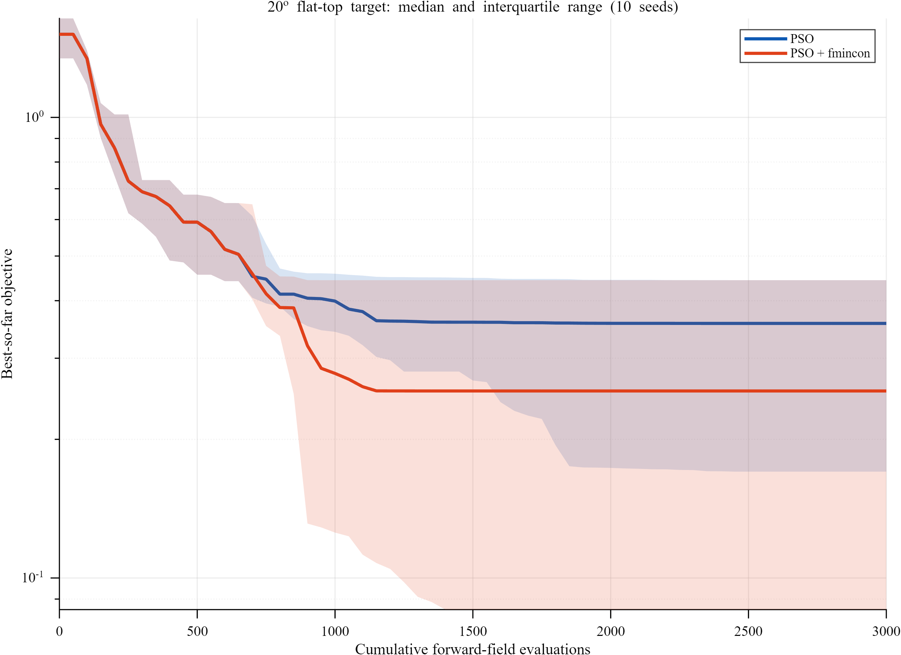
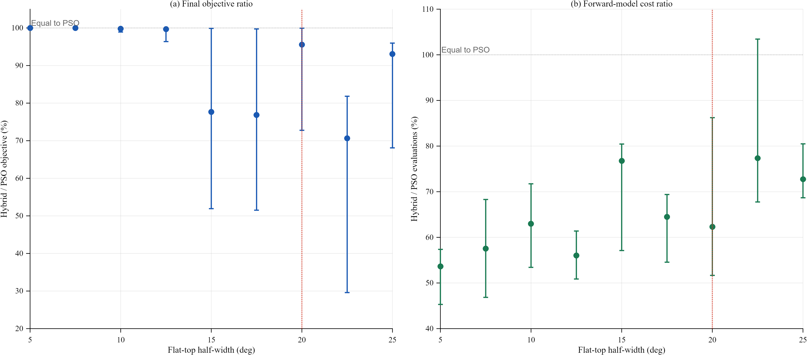
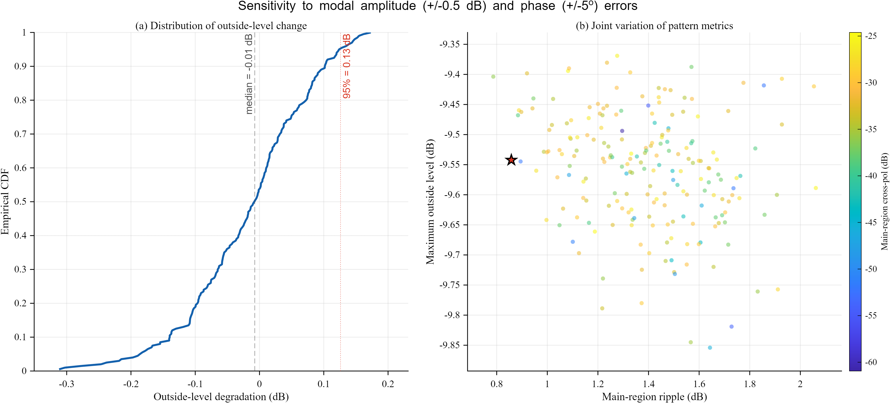

# 固定多模馈入口的矩形喇叭口平顶波束综合

## 摘要

矩形波导的开口场决定了其远区辐射特性。单一 TE10 模式具有稳定而简单的场分布，但难以同时获得宽波束和平坦主区；扩大辐射口径虽然能够增强方向性、降低远角辐射，却通常进一步缩窄波束。本文保留 20 mm × 10 mm、30 GHz 的固定多模波导馈入口，在其前端引入矩形渐变喇叭，并利用多个传播模式的复幅度叠加调节开口场。研究建立了从 TE/TM 解析模式、1 W 功率归一化、理想缓变口径映射到矢量远场计算的完整模型，并分别采用直接口径积分和二维 FFT 实现近远场变换。在此基础上，对喇叭开口尺寸、模态组合和优化算法进行分层研究。

数值结果表明，40 mm × 20 mm、渐变长度 60 mm 的喇叭口能够为 ±20°平顶波束保留较宽的天然辐射范围。由 TE10、TE20、TE30、TE11 和 TM11 五个模式组成的最终解，将 E/H 两个主切面中的最坏主区波纹由 4.59 dB 降至 0.858 dB，并使 H 面半功率波束宽度由 32.47°增加至 50.44°。相应的过渡区外最大辐射为 −9.54 dB，反映了宽主瓣、主区平坦度与区外抑制之间的折中。直接积分与 FFT 的归一化功率均方根误差分别为 $2.94\times10^{-7}$ 和 $8.77\times10^{-8}$；200 次幅相扰动试验中，区外电平变化的 95%分位为 0.126 dB。

**关键词：** 矩形波导；矩形喇叭；多模合成；口径场；傅里叶远场；粒子群优化；平顶波束

## 目录

- [1. 引言](#1-引言)
- [2. 电磁理论基础](#2-电磁理论基础)
- [3. 计算模型与优化方法](#3-计算模型与优化方法)
- [4. 结果与讨论](#4-结果与讨论)
- [5. 模型局限与后续工作](#5-模型局限与后续工作)
- [6. 结论](#6-结论)
- [7. 复现方法与数据组织](#7-复现方法与数据组织)
- [8. 参考文献](#8-参考文献)

## 1. 引言

### 1.1 从波导传输到开口辐射

矩形波导是一种由金属壁约束电磁波传播的导波结构。与同轴线中的 TEM 波不同，空心矩形波导中的场以横电模式（TE）或横磁模式（TM）传播。金属壁要求切向电场为零，这一边界条件只允许特定的横向场分布存在；每一种允许的分布称为一个波导模式。

当波导末端封闭时，能量继续被金属边界限制；当末端敞开时，口径上的切向电磁场会向自由空间辐射。远处某一观察方向上的场，可以理解为整个开口上各位置辐射的相干叠加。因此：

- 开口越大，来自不同位置的相位差随观察角变化越快，波束通常越窄；
- 开口场越均匀，主瓣通常越集中，但边缘突变可能带来明显旁瓣；
- 开口场中存在不同空间节点时，可以通过相长与相消重新分配角域能量。

普通直波导通常由 TE10 基模工作。它结构简单，却只提供一种固定的口径分布。若希望在较宽角域内保持近似恒定的辐射强度，仅改变整体功率无法改变方向图形状，需要进一步调节开口场的空间结构。

### 1.2 喇叭口与多模综合的作用

矩形喇叭通过逐渐扩大波导截面，使导波场较平缓地过渡到自由空间。扩大开口可以提高口径利用率并改善远角辐射，但也会使天然波束收窄，这与宽平顶波束的需求相冲突。多模综合提供了第二个调节维度：TE20、TE30、TE11、TM11 等高阶模式具有不同数量和方向的场节点，将它们以适当的幅度和相位叠加，可以改变口径场的曲率、零点和局部极化方向。

本文关注的工程问题不是单纯追求更大的喇叭，而是研究以下耦合关系：

1. 固定馈入口能够提供哪些传播模式，它们的场结构有何差异；
2. 喇叭口尺寸如何改变宽波束和平坦主区之间的关系；
3. 在有限活跃模式数下，哪些同相和反相组合能够形成宽平顶方向图；
4. 全局与局部优化方法在解质量、计算量和随机稳定性上有何差异；
5. 最终模态组合对幅度和相位误差有多敏感。

研究流程如图 1 所示：20 mm × 10 mm 固定波导先经过 40 mm 直段，再由长度 $L$ 的四面渐变结构扩展到 $A\times B$ 开口；$x$、$y$ 分别沿波导宽边和窄边，传播方向为 $+z$。H 面对应 $xz$ 主切面，E 面对应 $yz$ 主切面。

*图 1　固定多模馈入口、矩形渐变喇叭、开口尺寸与 E/H 主切面定义。[矢量 PDF](results/figures/01_model_geometry.pdf)*

## 2. 电磁理论基础

### 2.1 TE/TM 模式与截止条件

设矩形波导宽边为 $a$、窄边为 $b$，电磁波沿 $+z$ 传播。自由空间波数和第 $(m,n)$ 个模式的截止波数为

$$
k_0=\frac{2\pi f}{c_0},\qquad
k_c^2=\left(\frac{m\pi}{a}\right)^2+
\left(\frac{n\pi}{b}\right)^2 .
$$

对应的截止频率和传播常数为

$$
f_c=\frac{c_0}{2}
\sqrt{\left(\frac{m}{a}\right)^2+\left(\frac{n}{b}\right)^2},
\qquad
\beta=\sqrt{k_0^2-k_c^2}.
$$

只有 $f>f_c$ 时 $\beta$ 为实数，模式才能沿波导持续传输。TE 模式允许 $m$ 或 $n$ 中一个为零，但不存在 TE00；TM 模式要求 $m,n\geq1$。模态阻抗分别为

$$
Z_{\mathrm{TE}}=\frac{\omega\mu}{\beta},
\qquad
Z_{\mathrm{TM}}=\frac{\beta}{\omega\epsilon}.
$$

随着工作频率接近截止频率，$\beta$ 减小，TE 模态阻抗升高而 TM 模态阻抗降低。这意味着临界高阶模式不仅具有更多横向节点，也更容易受到结构尺寸、激励和频率变化的影响。

图 2 给出了 20 mm × 10 mm 波导在 30 GHz 下的模式分布。TE10 的截止频率最低，为 7.5 GHz；工作频率以下共有 10 个传播模式。TE02 和 TE40 恰位于 30 GHz，此时 $\beta=0$，因此不作为稳定的传输自由度参与波束综合。

*图 2　20 mm × 10 mm 矩形波导的 TE/TM 模式截止频率。绿色区域对应 30 GHz 下可传播的模式。[矢量 PDF](results/figures/02_mode_cutoff_catalog.pdf)*

### 2.2 矢量模态场与功率归一化

代码分别从 TE 模式的纵向磁场 $H_z$ 和 TM 模式的纵向电场 $E_z$ 出发，根据 Maxwell 方程计算 $E_x,E_y,H_x,H_y$。这种表示保留了电场的方向信息，而不是把 $E_x$ 与 $E_y$ 合并成缺乏几何意义的复标量。

第 $q$ 个模式沿 $+z$ 方向传输的时均功率为

$$
P_q=\frac{1}{2}\operatorname{Re}
\iint_A
\left(E_{x,q}H_{y,q}^{*}-E_{y,q}H_{x,q}^{*}\right)\,\mathrm dA .
$$

所有场分量统一乘以 $1/\sqrt{P_q}$，使每个模式都以 1 W 传播功率为基准。归一化后的多模横向电场为

$$
\mathbf E_t(x,y)=\sum_{q=1}^{Q}w_q\mathbf E_{t,q}(x,y),
\qquad
w_q=\rho_q e^{\mathrm j\varphi_q},
$$

并令

$$
\sum_q|w_q|^2=1,\qquad
\varphi_{\mathrm{TE10}}=0 .
$$

第一项保证不同组合在相同总输入功率下比较；第二项消除所有模式同时旋转相同相位所形成的等价解。

图 3 按模式阶数系统展示了九个传播模式。第一行 TE$m0$ 模式只沿 $x$ 方向增加节点；第二行 TE$m1$ 同时具有 $x$ 和 $y$ 向变化；第三行 TM$m1$ 的矢量场又呈现不同的汇聚、发散与旋转结构。列方向从 $m=1$ 增至 $m=3$ 时，横向零点数随之增加。这些不同的空间奇偶性构成多模波束综合的基函数集合。

*图 3　TE10–TE30、TE11–TE31 与 TM11–TM31 的归一化横向电场。底色为 $|\mathbf E_t|$，白色箭头表示瞬时电场方向。[矢量 PDF](results/figures/03_mode_field_atlas.pdf)*

### 2.3 从口径场到远区方向图

对观察方向 $(\theta,\phi)$，口径场的二维空间频谱为

$$
F_x(k_x,k_y)=
\iint_A E_x(x,y)e^{\mathrm j(k_xx+k_yy)}\,\mathrm dx\,\mathrm dy,
$$

$$
F_y(k_x,k_y)=
\iint_A E_y(x,y)e^{\mathrm j(k_xx+k_yy)}\,\mathrm dx\,\mathrm dy,
$$

其中

$$
k_x=k_0\sin\theta\cos\phi,\qquad
k_y=k_0\sin\theta\sin\phi .
$$

由横向谱场得到球坐标场分量

$$
E_\theta=F_x\cos\phi+F_y\sin\phi,
$$

$$
E_\phi=\cos\theta
\left(-F_x\sin\phi+F_y\cos\phi\right),
$$

总辐射强度正比于

$$
U(\theta,\phi)=|E_\theta|^2+|E_\phi|^2 .
$$

TE10 的主电场沿全局 $y$ 方向。以该方向为共极化参考，Ludwig-3 共、交极化写为

$$
E_{\mathrm{co}}=E_\theta\sin\phi+E_\phi\cos\phi,
\qquad
E_{\mathrm{cross}}=E_\theta\cos\phi-E_\phi\sin\phi .
$$

这一矢量变换使 E/H 两个主切面的功率、共极化和交叉极化能够在同一模型中评价。

## 3. 计算模型与优化方法

### 3.1 研究设定

| 参数 | 数值 |
|---|---:|
| 工作频率 | 30 GHz |
| 自由空间波长 | 10 mm |
| 固定馈入口 | 20 mm × 10 mm |
| 直波导段长度 | 40 mm |
| 传播模式数 | 10 |
| 开口宽度 $A$ | 40、50、60、70、80 mm |
| 开口高度 $B$ | 20、30、40、50、60 mm |
| 渐变长度 $L$ | 60、80、100、120 mm |
| 最大 H/E 面半张角 | 25° |
| 平顶半宽扫描 | 5°–25°，间隔 2.5° |
| 几何阶段过渡宽度 | 5°、10°、15°、20° |
| 最大活跃模式数 | 6 |

馈入口尺寸在整个研究中保持不变，因此传播模式集合始终由 20 mm × 10 mm 截面定义。这样可以把“输入模式控制”和“辐射口径扩大”分开，避免随着开口尺寸变化重新引入大量独立端口模式。

### 3.2 理想缓变喇叭口模型

快速模型把馈入口模式在归一化坐标中的场形状伸展到 $A\times B$ 开口：

$$
x'=x\frac{A}{a},\qquad
y'=y\frac{B}{b},
$$

并按

$$
\mathbf E'_t=
\frac{\mathbf E_t}{\sqrt{(A/a)(B/b)}}
$$

缩放场幅度，使每个映射模式仍保持 1 W 积分功率。喇叭半张角为

$$
\alpha_H=\tan^{-1}\frac{A-a}{2L},
\qquad
\alpha_E=\tan^{-1}\frac{B-b}{2L}.
$$

该模型用于快速研究“理想口径扩大”对方向图的影响。正式计算不人为加入经验性的二次相位误差，因此在同一 $A/B$ 下，$L$ 只参与张角约束，不直接改变开口场。最终选取的 60 mm 是扫描集合中满足角度约束的最短代表长度，而不是由该快速模型辨识出的传播最优长度。

### 3.3 平顶目标与评价量

设平顶半宽为 $\theta_0$，过渡宽度为 $\Delta\theta$。目标幅度定义为

$$
T(\theta)=
\begin{cases}
1, & |\theta|\leq\theta_0,\\[4pt]
\dfrac{1}{2}
\left[
1+\cos\left(
\pi\dfrac{|\theta|-\theta_0}{\Delta\theta}
\right)
\right],
& \theta_0<|\theta|<\theta_0+\Delta\theta,\\[8pt]
0, & |\theta|\geq\theta_0+\Delta\theta .
\end{cases}
$$

模型在功率域拟合 $T^2(\theta)$。优化目标同时包含 E/H 两个主切面的四部分误差：

$$
J=
4J_{\mathrm{main}}
+2J_{\mathrm{transition}}
+12J_{\mathrm{outside}}
+10J_{\mathrm{cross}} .
$$

$J_{\mathrm{main}}$ 和 $J_{\mathrm{transition}}$ 分别描述主区与过渡区的均方拟合误差，$J_{\mathrm{outside}}$ 描述过渡区外的平均功率，$J_{\mathrm{cross}}$ 描述主区交叉极化功率。结果分析另外报告三项直观物理量：

$$
R_{\mathrm{main}}
=\max_{\Omega_m}P_{\mathrm{dB}}
-\min_{\Omega_m}P_{\mathrm{dB}},
$$

$$
S_{\mathrm{outside}}
=\max_{|\theta|\geq\theta_0+\Delta\theta}P_{\mathrm{dB}},
$$

$$
X_{\mathrm{main}}
=20\log_{10}
\frac{\max_{\Omega_m}|E_{\mathrm{cross}}|}
{\max_{\Omega}|E_{\mathrm{co}}|}.
$$

其中 $R_{\mathrm{main}}$ 是主区波纹，$S_{\mathrm{outside}}$ 是过渡区外最大辐射，$X_{\mathrm{main}}$ 是主区交叉极化。

### 3.4 分层优化

几何与模态权重分两层处理：

1. **几何扫描。** 对预先给定的 $A/B/L/\Delta\theta$ 组合建立口径基函数，使用复数最小二乘产生确定性初值，再由 fmincon 精炼。候选根据主区波纹、区外辐射、交叉极化、开口面积和目标值综合比较。
2. **权重优化。** 几何锁定后，在九个平顶半宽上比较 LS+fmincon、粒子群优化（PSO）和 PSO+fmincon。
3. **稀疏化。** 连续优化完成后按权重幅度保留最强的至多六个模式，并在缩减后的变量空间重新优化。
4. **统计比较。** PSO 与混合算法均采用种子 0–9、最多 3000 次前向场计算。收敛历史按累计前向计算次数记录，而不是按不同算法之间不可直接比较的迭代次数记录。

PSO 用于搜索多个可能的吸引域，fmincon 用于在较优邻域内继续精炼。复数最小二乘则提供与目标场形状一致的确定性起点。三者分别承担线性近似、全局探索和局部收敛的作用。

### 3.5 两套远场实现与扰动试验

直接积分逐角度计算口径傅里叶积分，物理对应清晰但计算量较大；FFT 根据实际 $\Delta x,\Delta y$ 建立 $k_x,k_y$ 网格，并补偿首采样点坐标引入的相位。两种方法均采用二维梯形积分端点权重，FFT 的零填充只用于提高谱域插值密度。

在最终模态组合上，另对每个活跃模式施加独立的幅度和相位扰动：

$$
\Delta A_q\in[-0.5,0.5]\ \mathrm{dB},
\qquad
\Delta\varphi_q\in[-5^\circ,5^\circ],
$$

共生成 200 组样本，用于观察主区波纹、区外最大辐射和交叉极化的联合变化。

## 4. 结果与讨论

### 4.1 远场计算的一致性

图 4 对入选喇叭口上的 TE10 模式分别执行直接积分和 FFT。两条方向图在主瓣、零点和远区副瓣上几乎完全重合。E 面和 H 面的归一化功率均方根误差分别为 $2.94\times10^{-7}$ 和 $8.77\times10^{-8}$，峰值方向差均为 0°。误差主要集中在主瓣附近，但仍处于 $10^{-6}$量级。

*图 4　直接口径积分与二维 FFT 在 E/H 主切面上的独立计算结果。下排为逐角度归一化功率绝对差。[矢量 PDF](results/figures/04_numerical_validation.pdf)*

空间网格由 129×65 加密到 257×129 后，TE10 半功率波束宽度变化 0.0072%，区外最大值变化 0.00046 dB。直接积分、FFT 和网格加密给出的共同趋势表明，后续几何与权重比较不依赖某一种离散实现。

### 4.2 开口尺寸决定平坦度与区外抑制的权衡

图 5 汇总了 20°平顶半宽和20°过渡宽度下的开口尺寸扫描。两幅热力图直接使用主区波纹和区外最大辐射，而不是将多项指标压缩成一个缺乏物理直觉的综合分数。

*图 5　不同开口宽度 $A$ 和高度 $B$ 下的主区波纹、区外最大辐射及二者关系。星号为40 mm × 20 mm方案。[矢量 PDF](results/figures/05_geometry_tradeoff.pdf)*

扫描呈现出清楚但并非单调的结构。以 $A=40$ mm 为例，将 $B$ 从20 mm增至40 mm时，区外最大辐射由 −9.55 dB降至 −15.10 dB，但主区波纹由0.86 dB增至11.58 dB。开口高度增加后，E 面傅里叶谱明显收窄，远角能量下降；与此同时，原本较窄的天然波束难以覆盖 ±20°主区，导致边缘功率快速降低。

沿宽边扩大开口也会增加 $x$ 向场节点的角域振荡。例如在 $B=20$ mm时，将 $A$ 从40 mm增至60 mm，主区波纹由0.86 dB增至7.87 dB，而综合区外最大值仍约为 −9.57 dB。这是因为最终指标取 E/H 两个切面中的较不利者：只改善一个切面并不能自动改善双切面结果。

因此，40 mm × 20 mm并不是“方向性最强”的开口，而是保留宽天然波束后再利用多模干涉修正主区的折中尺寸。其 H/E 面半张角分别为9.46°和4.76°，在扫描范围内保持了较缓的几何渐变。

### 4.3 五模合成如何形成宽平顶方向图

图 6 比较直波导 TE10、设计目标和最终五模喇叭口结果。灰色 TE10 基线从中心向两侧持续下降，在 ±20°范围内形成4.59 dB起伏；多模合成后的红色曲线在两个主切面内均形成近似水平的平台，最坏波纹降至0.858 dB，减少81.3%。

*图 6　直波导 TE10 基线、20°平顶目标与最终多模喇叭口方向图。蓝色为主区，橙色为余弦过渡区。[矢量 PDF](results/figures/06_pattern_synthesis.pdf)*

H 面半功率波束宽度由32.47°增加至50.44°，增幅55.4%；最终 E 面和 H 面半功率波束宽度分别为55.48°和50.44°。主区展宽并不是由整体增益缩放产生，而是高阶模式在中心附近略微削弱 TE10 峰值、同时在主区边缘补充辐射的结果。

能量重新分配也带来相应代价。优化结果在过渡区外的最大辐射为 −9.54 dB，E 面远角区域形成较宽的平台，H 面则出现约 −20 dB的局部副瓣。固定口径和有限模式数无法同时任意控制所有观察角；更宽、更平的主区需要从中心峰值和部分远角抑制能力中交换自由度。

最终活跃模式及其归一化复权重为：

| 模式 | 幅度 | 相对相位 |
|---|---:|---:|
| TE10 | 0.3345 | 0° |
| TE20 | 0.5883 | 180° |
| TE30 | 0.4377 | 0° |
| TE11 | 0.2267 | −180° |
| TM11 | 0.5468 | 0° |

图 7 使用有符号系数将幅度和相位合并表示。TE20、TE11 与 TE10、TE30、TM11 基本形成两组反相分量。左图中的符号反转对应口径不同区域中的相消与相长；右图可以看到，合成场不再是关于中心的单峰 TE10 分布，而形成偏移的高场区、弯曲的低场带和随位置变化的矢量方向。这些结构共同改变远场平台曲率和滚降速度。

*图 7　五个活跃模式的有符号归一化系数，以及按相应复权重叠加得到的喇叭开口横向电场。[矢量 PDF](results/figures/07_modal_composition.pdf)*

这里的模态系数建立在每个模式先归一化为 1 W 的基础上，不等同于某一实际馈电端口的电压设置。将这些复权重转换为可加工的耦合器、功分网络或模式变换器，是后续工程设计的一部分。

### 4.4 优化算法的收敛与宽度依赖

图 8 以累计前向场计算次数为横轴，比较纯 PSO 与 PSO+fmincon。两种方法在早期都依赖粒子群快速降低目标值；约700–900次计算后，纯 PSO 的中位曲线逐渐进入平台，而混合方法利用局部优化继续下降。到计算结束时，10个种子的聚合中位目标值分别约为0.357和0.255。

*图 8　20°平顶目标下 PSO 与 PSO+fmincon 的历史最优目标值。实线为10个随机种子的中位数，阴影为四分位区间。[矢量 PDF](results/figures/08_algorithm_convergence.pdf)*

橙色四分位带在后期仍然较宽，说明混合方法并非对所有随机种子都产生相同收益：当 PSO 初始阶段进入较好的吸引域时，fmincon 能够迅速精炼；若进入不同的局部结构，最终目标值仍会存在明显差异。这也是不能只报告单个最好种子的原因。

图 9 将比较扩展到5°–25°共九个目标半宽。纵轴改为混合算法与 PSO 的比值，因此100%表示两者相当，小于100%表示混合方法使用更低目标值或更少前向计算。

*图 9　九个平顶半宽下，混合算法相对于 PSO 的最终目标值比和前向计算量比。点为配对种子的中位数，误差棒为四分位区间；红色虚线标记20°研究点。[矢量 PDF](results/figures/09_width_sweep.pdf)*

窄目标下两种算法的最终目标值接近，说明问题本身较容易由基础模态逼近。目标半宽增至15°以上后，多模干涉关系更加复杂，局部精炼在部分宽度上表现出更明显的目标值改善。20°处配对中位目标值比为95.6%，前向计算量比为62.3%，即在保持相近解质量的同时减少约37.7%的前向场计算。不同宽度上的误差棒并不呈单调变化，表明算法收益取决于目标形状、活跃模式组合和粒子群初始吸引域，而不是一个固定常数。

图 8 的“聚合终点中位数”和图 9 的“按随机种子配对后的比值中位数”回答不同问题，因此数值并不要求相互等同：前者描述两组终点分布的中心，后者描述相同种子条件下的相对变化。

### 4.5 幅相误差对方向图的影响

图 10 给出了200组独立幅相扰动结果。区外电平变化的中位数为 −0.01 dB，95%分位为0.126 dB，完整样本范围约为 −0.31–0.17 dB，说明在设定扰动范围内，区外最大辐射对小幅复权重误差相对稳定。

*图 10　模态幅度 ±0.5 dB、相位 ±5°时的区外电平经验分布，以及主区波纹、区外电平和交叉极化的联合散点。[矢量 PDF](results/figures/10_robustness.pdf)*

主区波纹表现出更高敏感性，从名义值0.858 dB扩展到0.787–2.061 dB，中位数为1.405 dB。这一差异可以从相干叠加机制理解：区外最大值由较宽角域中的局部峰值决定，小扰动可能使不同峰值之间相互替代；主区平坦度则依赖五个模式在整个 ±20°范围内维持精确的相消与补偿，因此对相对幅相更敏感。

交叉极化样本约分布在 −61至 −25 dB之间。虽然其绝对值仍较低，但变化范围较宽，说明极化性能同样依赖 TE/TM 模式之间的相位一致性。实际馈电网络的设计应优先控制相对相位，并进一步研究未激励通道泄漏和模式纯度。

### 4.6 主要数值结果

| 项目 | 数值 |
|---|---:|
| 固定馈入口 | 20 mm × 10 mm |
| 入选喇叭开口 | 40 mm × 20 mm |
| 渐变长度 | 60 mm |
| H/E 面半张角 | 9.46° / 4.76° |
| 馈入口传播模式数 | 10 |
| 最终活跃模式数 | 5 |
| TE10基线最坏主区波纹 | 4.594 dB |
| 多模合成最坏主区波纹 | 0.858 dB |
| 波纹降低比例 | 81.3% |
| E/H面半功率波束宽度 | 55.48° / 50.44° |
| H面波束宽度增加比例 | 55.4% |
| 过渡区外最大辐射 | −9.542 dB |
| 主区交叉极化 | −100.6 dB |
| 直接积分/FFT功率RMSE | $2.94\times10^{-7}$ / $8.77\times10^{-8}$ |
| 20°处混合算法/PSO计算量比 | 62.3% |
| 区外电平变化95%分位 | 0.126 dB |

## 5. 模型局限与后续工作

### 5.1 理想缓变模型的适用范围

当前 MATLAB 模型用于研究模式结构、口径尺度和优化方法之间的关系。它把馈入口模式无反射地伸展到更大开口，因此没有显式描述：

- 有限渐变长度产生的相位误差和模态转换；
- 波导—喇叭连接处的反射；
- 开口边缘绕射、有限壁厚、法兰和材料损耗；
- 制造误差对几何尺寸与模式纯度的影响；
- 实际模式激励网络中的耦合、泄漏和功率承受能力。

因此，本文结果应理解为固定模式集合和理想缓变口径下的数值研究，而不是已加工天线的最终增益或效率预测。

### 5.2 全波验证

仓库中的 PyAEDT 脚本计划建立 20 mm × 10 mm直段馈入、40 mm × 20 mm开口和60 mm渐变长度的完整三维结构，并分别导出各端口本征模的复数 $E_\theta,E_\phi$。随后可在 MATLAB 中按五模权重相干叠加，与解析口径模型比较峰值方向、半功率波束宽度和主瓣形状。

当前本机 AEDT 2025 R2能够启动，但 PyAEDT 0.9.6尚未成功建立 HFSS设计对象，因此全波方向图尚未生成。下一步需要使用匹配的 Python/PyAEDT 环境确认许可证和设计创建，再完成端口模式识别、网格收敛和复数远场导出。

### 5.3 后续研究方向

1. 在全波模型中比较不同 $L$ 对反射、开口相位误差和模式转换的影响；
2. 将解析模式模板与 HFSS 端口本征场做相关匹配，量化模式纯度；
3. 把馈电网络参数纳入优化，使复权重从数学变量转化为可实现的耦合结构；
4. 将机械尺寸误差、关闭通道泄漏和频率偏移加入联合不确定性分析；
5. 在保持双切面平坦度的同时研究更连续的口径加权或不同喇叭轮廓。

## 6. 结论

本文建立了一个固定多模馈入口矩形喇叭的解析建模与优化流程。研究表明，喇叭口尺寸并非越大越适合宽平顶波束：扩大开口能够降低远角辐射，却会缩窄天然波束并加剧宽主区内的功率起伏。40 mm × 20 mm开口保留了相对宽的基础辐射范围，为后续多模整形提供了更合适的起点。

TE10、TE20、TE30、TE11和TM11的同相/反相组合显著改变了口径场结构，使双切面主区波纹降低81.3%，同时将H面半功率波束宽度增加55.4%。区外最大辐射为−9.54 dB，体现了有限口径和有限模式数下宽度、平坦度与远角抑制之间的能量分配关系。

算法比较进一步说明，PSO提供全局探索能力，fmincon适合在较优吸引域内精炼，但混合方法的收益随目标宽度和随机初值而变化。幅相扰动试验则表明，区外最大值较稳定，而主区平坦度对相对幅相更敏感。后续全波模型和实际馈电网络应围绕模式纯度、相位控制与有限长度效应展开。

## 7. 复现方法与数据组织

### 7.1 环境

- MATLAB R2025a；
- Optimization Toolbox；
- Global Optimization Toolbox；
- HFSS 自动化脚本面向 AEDT 2025 R2。

### 7.2 一键重建

~~~matlab
cd('D:\homework\电磁学小论文\waveguide_farfield')

% 重建 MATLAB 测试、CSV、MAT 数据及全部图件
outputs = run_all('RunHfss',false);

% 在 MATLAB 流程之后额外尝试 HFSS 自动化
outputs = run_all('RunHfss',true);
~~~

分步运行：

~~~matlab
run_tests();
run_baseline();
run_geometry_scan();
run_optimization();
run_validation();
~~~

### 7.3 仓库结构

| 路径 | 内容 |
|---|---|
| **matlab/+wg/** | 模态场、喇叭映射、远场求解、优化、统计与绘图函数 |
| **tests/** | 截止、边界、功率、正交性、远场一致性和几何模型测试 |
| **hfss/** | PyAEDT 环境预检、三维建模与远场导出脚本 |
| **results/tables/** | 可直接检查和二次绘图的 CSV 数据 |
| **results/data/** | 完整 MATLAB 结果结构 |
| **results/figures/** | 300 dpi PNG 与矢量 PDF |
| [docs/theory.md](docs/theory.md) | 理论公式的紧凑说明 |
| [docs/validation.md](docs/validation.md) | 数值检查与全波设置记录 |

主要数据文件：

- **mode_catalog.csv**：模式名称、截止频率、传播常数和模态阻抗；
- **geometry_scan.csv**：开口尺寸、渐变长度、过渡宽度和方向图指标；
- **patterns.csv**：各传播模式的 E/H 面方向图；
- **modal_weights.csv**：不同目标宽度下的模态复权重；
- **optimization_runs.csv**：算法、目标宽度、随机种子、计算量和最终指标；
- **convergence_history.csv**：按累计前向计算次数记录的历史最优值；
- **paper_metrics.csv**：算法中位数、四分位数和配对比较结果；
- **validation_summary.csv** 与 **grid_convergence.csv**：直接积分/FFT及网格加密结果。

## 8. 参考文献

1. R. E. Collin, *Foundations for Microwave Engineering*, 2nd ed., Wiley–IEEE Press, 2001.
2. C. A. Balanis, *Antenna Theory: Analysis and Design*, 4th ed., Wiley, 2016.
3. A. C. Ludwig, “The definition of cross polarization,” *IEEE Transactions on Antennas and Propagation*, vol. 21, no. 1, pp. 116–119, 1973. [DOI: 10.1109/TAP.1973.1140406](https://doi.org/10.1109/TAP.1973.1140406)
4. J. Kennedy and R. Eberhart, “Particle swarm optimization,” *Proceedings of ICNN’95 — International Conference on Neural Networks*, vol. 4, pp. 1942–1948, 1995. [DOI: 10.1109/ICNN.1995.488968](https://doi.org/10.1109/ICNN.1995.488968)

---
