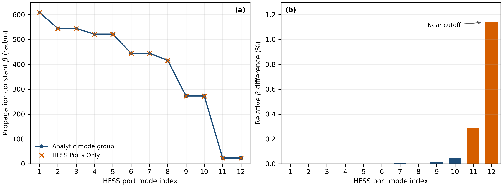
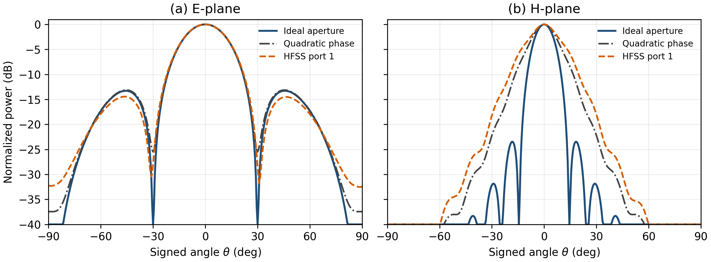
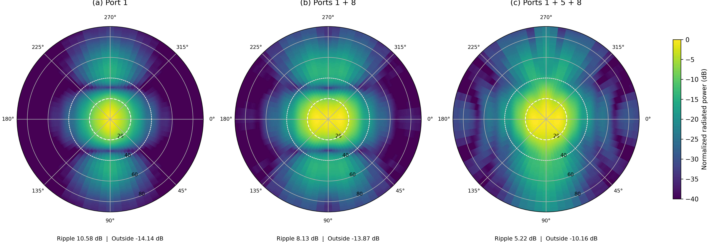
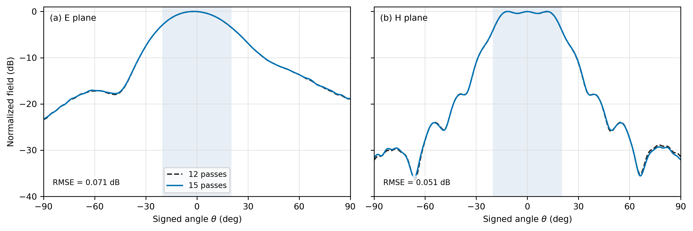

# HFSS 全波模态与方向图综合

本目录保存 30 GHz 矩形喇叭的 AEDT 2025 R2 建模、复数远场导出及结果分析。几何为 20 × 10 mm 馈入口、60 × 20 mm 开口和 60 mm 渐变段。本文比较各自按峰值归一化的方向图；多模曲线由同一全波工程的原生模态复数远场相干合成。

MATLAB 理想缓变口径模型用于几何与模态机理研究；本目录的多模优化直接使用 HFSS 嵌入远场。两组权重来自各自的前向模型，分别呈现解析设计和全波角谱综合的结果。

## 1. 馈入口模式与喇叭口相位

按精确真空光速计算，20 × 10 mm 馈入口在 30 GHz 有 12 个传播模式。端口专用求解给出的传播常数与解析模式分组一致，最大相对差为 1.14%，出现在接近截止的模式组。

*图 1　12 个端口模式的 HFSS 传播常数与解析值。横轴为端口序号；接近截止的模式具有较小传播常数。[矢量 PDF](../results/hfss/port_only_native_validation_20261026/port_only_dispersion.pdf)*

固定喇叭几何后，端口 1 单模方向图为观察口径相位的参照。零相位口径近似在 E 面的归一化方向图 RMSE 为 1.00 dB；将由喇叭尺寸确定的二次相位引入口径场后，H 面 RMSE 由 17.44 dB 降至 2.83 dB。开口相位曲率对 H 面波束形状有显著影响。

*图 2　同一喇叭的 HFSS 端口 1、零相位口径近似及几何二次相位近似的 E/H 面归一化方向图。[矢量 PDF](../results/hfss/twelve_mode_60x20x60_phase_sensitivity_20261027/te10_phase_comparison.pdf)*

## 2. 复数模态综合

在原生模态激励参考下，将端口 1、5、8 的嵌入远场组成三模基底。入射功率归一化的复幅度如下；角度以端口 1 为相位参考。

| 端口 | 幅度 | 相位 | 功率占比 |
|---|---:|---:|---:|
| 1 | 0.821809 | 0° | 0.675 |
| 5 | 0.513387 | 15.553° | 0.264 |
| 8 | 0.247111 | −11.010° | 0.061 |

将这组权重写入 AEDT `EditSources` 后，直接求得的复数远场与离线计算的 $\sum_j w_j\mathbf E_j$ 在 80 个采样点上的相对误差为 $6.15\times10^{-16}$。这把优化变量与全波软件实际使用的复数激励联系起来。

15 轮网格上的完整二维前半空间角谱给出以下结果。主区为 $\theta\leq20^\circ$ 圆盘，区外为 $\theta\geq40^\circ$；每幅方向图各自按峰值归一化。

| 激励 | 主区波纹 | 区外最大电平 | 峰值方向 |
|---|---:|---:|---:|
| 端口 1 单模 | 10.579 dB | −14.141 dB | $\theta=0^\circ$ |
| 端口 1+5+8 | 5.222 dB | −10.164 dB | $\theta=11.5^\circ$ |

三模组合使主区起伏减少 5.357 dB，并把部分辐射重新分配到较大角度，形成平坦度与区外电平之间的权衡。模式 1+8 的双模阶段提供横向场调节，加入模式 5 后，二维主区形状进一步改善。

*图 3　相同几何下的单模、双模和三模归一化二维方向图；圆线对应 $\theta=20^\circ$ 与 $40^\circ$。[矢量 PDF](../results/hfss/twelve_mode_60x20x60_iterative_15pass_full_azimuth_comparison_20261028/intrinsic_2d_patterns_15pass.pdf)*

## 3. 网格对照与角谱稳定性

固定同一组三模权重，在 12 轮和 15 轮自适应网格上分别计算完整二维角谱。方向图高于 −20 dB 的区域中，单模与三模的归一化电平 RMSE 分别为 0.043 dB 和 0.067 dB；三模峰值方向均为 $\theta=11.5^\circ$。三模主区波纹为 5.208/5.222 dB，区外最大电平为 −10.198/−10.164 dB。归一化角谱形状对本次网格加密较稳定。

*图 4　相同三模权重在 12、15 轮网格上的 E/H 面方向图；完整二维误差数值来自全角域数据。[矢量 PDF](../results/hfss/twelve_mode_60x20x60_iterative_15pass_cut_comparison_20261028/mesh_stability_fixed_three_eh.pdf)*

## 4. 数据索引

| 内容 | 位置 |
|---|---|
| 端口传播常数与解析对照 | [`port_only_native_validation_20261026`](../results/hfss/port_only_native_validation_20261026/) |
| 口径相位敏感性 | [`twelve_mode_60x20x60_phase_sensitivity_20261027`](../results/hfss/twelve_mode_60x20x60_phase_sensitivity_20261027/) |
| 三模幅相、二维方向图与直接激励核对 | [`three_mode_2d_intrinsic`](../results/hfss/twelve_mode_60x20x60_three_mode_2d_intrinsic_20261027/)；[`composite_check`](../results/hfss/twelve_mode_60x20x60_three_mode_intrinsic_composite_check_20261027/) |
| 15 轮复数场与 12/15 轮完整角域对照 | [`full_azimuth_intrinsic`](../results/hfss/twelve_mode_60x20x60_iterative_15pass_full_azimuth_intrinsic_20261028/)；[`full_azimuth_comparison`](../results/hfss/twelve_mode_60x20x60_iterative_15pass_full_azimuth_comparison_20261028/) |
| 自动化脚本用法与 AEDT API 记录 | [`API_EXPERIENCE.md`](API_EXPERIENCE.md) |

结果图中的 dB 均相对于各方向图峰值；原始功率记录保存在数据目录中。
