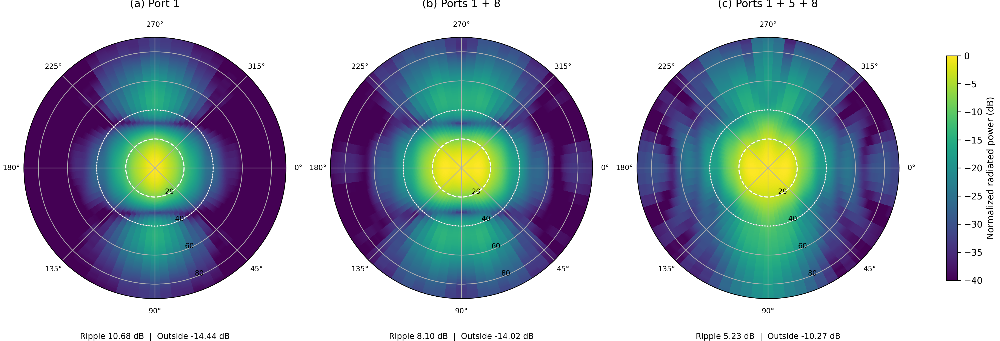

# HFSS 原生模态基底上的二维多模综合

研究对象为 30 GHz、20 × 10 mm 馈入口、60 × 20 × 60 mm 喇叭。12 个端口模式的复数远场来自**同一个已经收敛的三维 HFSS 解**，逐模采用 `IncludePortPostProcessing=False` 的原生模态激励参考。计算网格为 `θ=0:0.5:90°`、`φ=0:5:355°`。模式以 HFSS 端口序号标记：传播常数分组支持端口 1、8 分别为 TE10、TE30 候选；端口 5 的解析 TE/TM 身份尚无二维端口本征场唯一确认。

| 复激励 | θ≤20° 圆盘波纹 | θ≥40° 最大电平 | 主区交叉极化 | 峰向 |
|---|---:|---:|---:|---:|
| 端口 1 | 10.68 dB | −14.44 dB | 约 −30 dB | 轴向 |
| 端口 1+8 | 8.10 dB | −14.02 dB | 约 −30 dB | 轴向 |
| 端口 1+5+8 | 5.23 dB | −10.27 dB | −12.42 dB | θ=11°，φ=175° |

双模结果选自端口 1 与其余 11 个端口的逐对搜索；三模结果固定为 1/5/8，再比较复数最小二乘加局部优化、差分进化和差分进化加局部优化。三模全局搜索使用 10 个固定种子，每种子最多 3000 次前向场组合。最佳解来自种子 5；种子 6 也到达相近的低波纹吸引域，其余种子停留在约 8.1–8.3 dB 波纹。因此 5.23 dB 是已记录搜索中的最佳值，不是中位表现或全局最优证明。

HFSS 优化沿用 MATLAB 中 `4×主区均方误差 + 2×过渡区均方误差 + 12×区外均方功率 + 10×交叉极化均方功率` 的结构，主区半宽 20°、过渡宽度 20°、输入权重平方和为 1。差异在于：这里把前向基底换成真实有限喇叭的 HFSS 复数嵌入场，并把评价扩展到全部采样方位角。粗搜索使用 1°×10° 网格，表中指标在独立的 0.5°×5° 网格上复评。当前均方项对采样点等权；后续论文级复核应增加固体角权重与网格收敛分析，避免采样方式影响目标值。

最佳三模幅度为 `0.821809/0.513387/0.247111`，相对相位为 `0°/15.553°/−11.010°`；三者幅度平方之和为 1。模式 5 进一步填平二维主区，但主区交叉极化和区外辐射都升高。原始优化表为 [`optimization_runs.csv`](optimization_runs.csv)，激励表为 [`selected_weights.csv`](selected_weights.csv)，指标在 [`summary.json`](summary.json)。

*三个图共用 −40 至 0 dB 色标。白色圆圈标出 20° 主区和 40° 区外边界。[矢量 PDF](intrinsic_2d_patterns.pdf)*

三模权重已直接施加到 AEDT `EditSources`。直接报告与离线 `Σw_n E_n` 在 80 个复数角度样本上的相对 L2 误差为 `6.15×10⁻¹⁶`，回执见 [`../twelve_mode_60x20x60_three_mode_intrinsic_composite_check_20261027/receipt.json`](../twelve_mode_60x20x60_three_mode_intrinsic_composite_check_20261027/receipt.json)。这证明同一个全波解内的复数场组合与优化代码一致；没有重新进行三维求解，也没有验证原 MATLAB 理想口径权重或实际馈电网络。

原生激励下的接受功率约为 0.9979 W，但报告的辐射功率约为 1.0845 W，存在约 8.7% 的功率收支误差；因此本页仅比较**归一化方向图形状**。下一步优先完成独立网格加密求解，复查 PML/远场功率，再进行端口本征场匹配、更多稀疏模态组合与幅相扰动分析。
