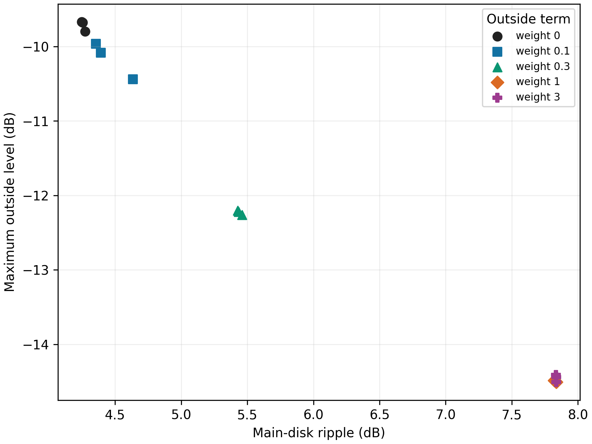

# 三端口复激励的二维方向图权衡扫描

固定 30 GHz、60 × 20 × 60 mm 喇叭和 HFSS 原生端口 1、5、8 的复数嵌入场，仅改变三路幅相。每次组合都满足输入权重平方和为 1；用 1°×10° 角网格优化，再在 0.5°×5° 网格评价。每个区外权重使用三个固定随机种子，每个种子 1312 次前向场组合。该扫描旨在辨认当前三模方案的平坦度与区外辐射权衡，不能证明全局 Pareto 前沿。

目标函数为 `主区波纹(dB)/10 + λ×10×区外最大线性功率 + 2×主区最大线性交叉极化功率`。`λ` 取 0、0.1、0.3、1、3；这是有别于原 MATLAB 加权均方误差目标的**探索性敏感度扫描**，不能将其目标值直接与原算法目标值比较。

| 区外权重 λ | 三个种子的二维主区波纹 | θ≥40° 最大电平 | 主区交叉极化 |
|---:|---:|---:|---:|
| 0 | 4.25–4.27 dB | −9.80 至 −9.67 dB | 约 −12 dB |
| 0.3 | 5.43–5.46 dB | −12.26 至 −12.20 dB | −15.22 至 −15.06 dB |
| 1 | 7.82–7.84 dB | −14.51 至 −14.48 dB | 约 −28.4 dB |

权重增大后，区外辐射和交叉极化同时降低，主区波纹上升。`λ=0.3` 的三个种子聚到相近结果，其中一种取得 **5.43 dB 波纹、−12.20 dB 区外电平、−15.06 dB 交叉极化**；说明先前固定目标下的 5.23/−10.27 dB 并非该三端口基底唯一的合理折中。但主区波纹仍远高于 1 dB，不能把满足另外两个数值条件表述为完整平顶设计。逐次结果见 [`tradeoff_runs.csv`](tradeoff_runs.csv)。

*每种颜色对应一个区外权重，每个点对应一个随机种子；横轴越小表示主区越平坦，纵轴越低表示区外抑制越好。[矢量 PDF](three_mode_tradeoff.pdf)*

当前均方与极值指标都来自离散角网格，端口 5 的 TE/TM 身份未由二维本征场唯一确认，且原始全波解的辐射功率仍高于接受功率。结果只用于归一化方向图权衡分析。加密网格 HFSS 解完成后，应复查该几何的功率收支和代表性三模方案，再考虑扩大到其他模态组合及多目标鲁棒优化。
