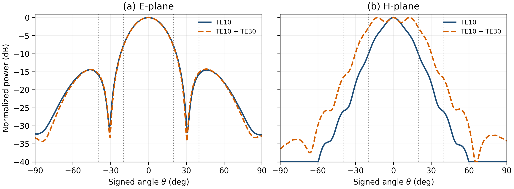

# HFSS 嵌入远场的双模主切面综合

对象为已求解的 60 × 20 × 60 mm 喇叭、30 GHz。**本次早期探索使用 AEDT 的 50 Ω 端口后处理参考**；其复权重和功率解释不能与后续原生模态激励数据混用。读取每次只激励一个端口模式
（输入 1 W）的复数嵌入远场切面，选取传播常数分别唯一对应 TE10 与 TE30
的端口 1、8。以端口 1 相位为零，搜索端口 8 的相对幅度和相位；总输入权重
按平方和归一化。目标函数沿用主区 ±20°、20°余弦过渡和区外功率的
E/H 双切面加权目标，另含交叉极化项。SciPy 差分进化使用 10 个固定种子，
输出 `optimization_runs.csv`。

| 全波嵌入场组合 | E 面 ±20°波纹 | H 面 ±20°波纹 | E/H 面 θ≥40°最大值 |
|---|---:|---:|---:|
| 仅端口 1 | 7.879 dB | 10.269 dB | −14.439 / −26.059 dB |
| 端口 1 + 8 | 8.110 dB | 2.925 dB | −14.271 / −16.690 dB |

最小加权目标由 1.559 降至 0.842，最佳端口 8/1 幅度比约 1.963、
相位差约 −101.51°。10 个种子收敛到两个局部区域，故这里给出的是
已记录预算和种子的最佳探索解，不宣称全局最优。TE30 改善了 H 面宽度
与平坦度，却基本不能修正 E 面的明显下降；因此两模结果不能称为
双切面平顶。由同一组 HFSS 嵌入场相干叠加得到曲线，未重新启动三维求解。



*图　蓝线为单模，橙线为复权重叠加；竖线依次标出 ±20°主区和
±40°过渡区外边界。完整范围统一显示至 −40 dB。[PDF](two_mode_eh_patterns.pdf)*

该研究只使用 E/H 两条切面，未检查两者之间的方位角；端口的相位由 HFSS
激励定义，不等于原 MATLAB 理想口径模式权重的相位基准。缺少馈电网络、
二维角域和扰动检验，不能作为最终天线方案。原始嵌入场见
`../twelve_mode_60x20x60_native_import_20261027/`。

在仓库根目录重算：

```powershell
python hfss/synthesize_two_mode_embedded.py `
  results/hfss/twelve_mode_60x20x60_native_import_20261027/hfss_port_mode_patterns.csv `
  <new-output-directory>
```
