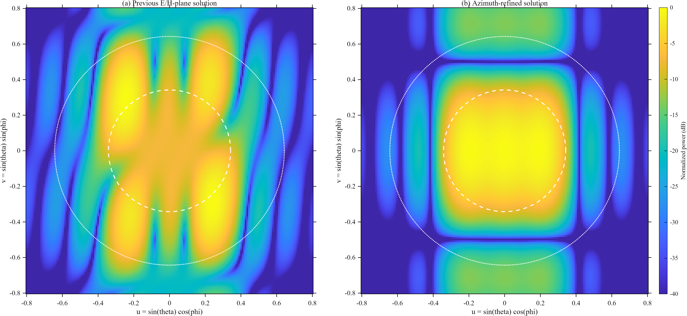

# 12 方位角重优化：主切面结果的二维检验

本研究保持 30 GHz、20 × 10 mm 馈入口、全部 12 个传播模式、60 × 20 × 60 mm
理想缓变喇叭口以及最多 6 个活跃模式不变。与此前仅评价 E/H 两个主切面不同，
优化阶段同时采样 12 条相隔 15° 的子午面；评价阶段在方向余弦平面
`u,v ∈ [−0.8,0.8]` 的 181 × 181 网格上检查可见空间。

| 数值模型 | 活跃模式 | 二维 ±20° 区域波纹 | θ≥40° 区域最大值 | 轴向相对峰值 |
|---|---:|---:|---:|---:|
| 原 E/H 主切面解 | 6 | 16.81 dB | −6.69 dB | −7.52 dB |
| 12 方位角重优化 | 4 | 8.35 dB | −13.26 dB | −0.06 dB |
| 仅保留 TE10、TE30 | 2 | 8.35 dB | −13.28 dB | −0.06 dB |

重优化明显消除了原解的离轴主峰，并降低了远角能量；但二维主区起伏仍很大，
不能将它称为合格的二维平顶波束。最坏采样子午面主区波纹约为 8.41 dB。
四个非零模式中，TE31 和 TM31 的幅度分别仅约 0.0028 和 0.0041；
将它们移除并把 TE10、TE30 重新归一化后，二维波纹变化约 −0.003 dB，
区外峰值变化约 −0.016 dB。这表明所得角谱几乎全部由 TE10 与 TE30
的相干叠加决定，微弱高阶分量不是二维性能改善的主要来源。
这组结果更适合作为“限制为少量馈入模式时，主区平坦度与区外抑制发生权衡”
的数值证据。图中的虚线表示 20°主区边界，点线表示 40°过渡区外边界；
色标对两幅图统一为 0 至 −40 dB，未裁切不利区域。



完整数值见 `tables/azimuth_refinement_metrics.csv`，复数幅相见
`tables/azimuth_refinement_weights.csv`，矢量图见
`figures/azimuth_refinement.pdf`。这些结果来自理想缓变口径映射，
相同几何现已取得 HFSS 全波单模及嵌入远场数据，但上述理想模型权重
尚无经端口相位校准的 HFSS 多模对照。重优化不改变旧几何扫描表，
也不把旧 40 × 20 mm 的 HFSS 解用于 60 × 20 mm 结构。

在仓库根目录用 MATLAB 复现：

```matlab
addpath(pwd, fullfile(pwd, 'matlab'));
run_full_azimuth_refinement();
```
